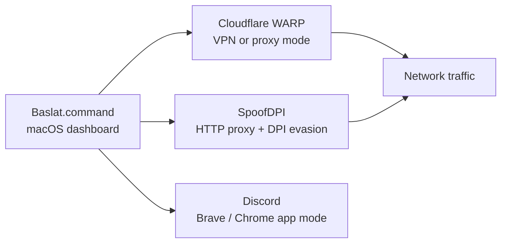

<div align="center">


# DPI for macOS

A small macOS orchestration layer around **Cloudflare WARP** and **[SpoofDPI](https://github.com/xvzc/SpoofDPI)**.
It does not implement a DPI bypass engine itself: it starts and coordinates the two upstream tools,
then opens Discord in a browser app window.

Türkçe hızlı başlangıç: WARP ve Discord'u bir kez açıp kapatın, ardından `Baslat.command` dosyasını
çalıştırın. WARP bağlantısı, SpoofDPI proxy'si ve Discord başlatma işlemi tek panelden yönetilir.

</div>

---

## What this project actually does



- **Cloudflare WARP** is Cloudflare's official client. The project only changes its mode and
  connection state through `warp-cli`.
- **SpoofDPI** is the DPI-evasion component. It is installed with Homebrew for native macOS use and
  built from source inside the Docker image.
- **The dashboard** is a local Python/WebView launcher. It displays status, starts and stops the
  tools, and keeps their output in one place.
- **Discord** is opened as a browser app or as the native application. This project does not modify
  Discord itself.

The repository is therefore a convenience wrapper and a small UI, not a replacement for WARP or
SpoofDPI. If you only need the underlying functionality, install those tools directly.

## Features

- One-click macOS launcher with a desktop-style dashboard
- Start/stop controls for WARP and SpoofDPI
- VPN and proxy modes for WARP
- Automatic SpoofDPI network configuration on macOS
- Discord launch through Brave, Chrome, the native app, or the default browser
- Optional LaunchAgent for starting the launcher at login
- Docker mode for running the SpoofDPI proxy in an isolated container
- Live status, logs, and latency chart

## Project structure

```text
DPI-for-macos/
├── Baslat.command              # Main macOS launcher
├── discord_launcher.py         # Dashboard, local HTTP server, and process control
├── Mac_GoodbyeDPI.command      # Legacy filename; starts SpoofDPI (not GoodbyeDPI)
├── Warp_Ayarlari.command       # WARP mode helper
├── Discord_Uygulamasi.command  # Discord helper
├── docker_start.command        # Docker helper
├── Dockerfile                  # SpoofDPI container image
├── docker-compose.yml
├── docker/entrypoint.sh
└── README.md
```

## Requirements

For native macOS mode:

- macOS and Homebrew
- Cloudflare WARP
- SpoofDPI
- Python 3
- Brave Browser (recommended) or another Chromium browser
- Discord (optional; the browser app mode does not need it)

```bash
brew install --cask cloudflare-warp
brew install spoofdpi
brew install --cask brave-browser
```

For Docker mode, install Docker Desktop. Docker mode runs **only SpoofDPI**; WARP and Discord stay
on the host.

## Usage

### Native macOS dashboard

```bash
./Baslat.command
```

From the dashboard:

1. Connect WARP in VPN or proxy mode.
2. Start SpoofDPI.
3. Launch Discord.

The first run may ask for your macOS administrator password. It is used for the `sudo` call that
lets SpoofDPI configure the network adapter; the password is kept in memory for the current session
only and is not written to disk.

### Manual helpers

```bash
./Warp_Ayarlari.command
./Mac_GoodbyeDPI.command
./Discord_Uygulamasi.command
```

### Docker

```bash
docker compose up -d --build
```

This builds SpoofDPI 1.5.5 from source and exposes its HTTP proxy on `http://127.0.0.1:8080`.
Point the application you want to route through SpoofDPI at that proxy. WARP is not started inside
the container, so start it separately on macOS if you need it.

Stop the container with:

```bash
docker compose down
```

## How the pieces fit together

1. WARP connects the host to Cloudflare's network, either as a full VPN or as a local proxy.
2. SpoofDPI listens as a local HTTP proxy and applies TCP/TLS fragmentation to evade DPI.
3. The launcher optionally sets the macOS system proxy to SpoofDPI.
4. Discord is opened in a separate browser app window so it uses the configured network path.
5. The dashboard polls `warp-cli`, the SpoofDPI process, and `discord.com` latency to show status.

SpoofDPI's default HTTP listener is `127.0.0.1:8080`. The Docker entrypoint binds it to `0.0.0.0`
inside the container and publishes only that port.

## ESP32 technical note

This project cannot run on an ESP32, and the repository does not include ESP32 firmware. The
components above require a general-purpose operating system:

- WARP is a userspace client with its own tunnel and routing integration.
- SpoofDPI needs a full TCP/IP stack, raw packet manipulation, TLS ClientHello handling, and a
  local proxy listener.
- The launcher uses macOS process control, `warp-cli`, `sudo`, and a WebView dashboard.

An ESP32 has no macOS networking APIs, cannot execute either binary, and does not have enough RAM
or CPU headroom for transparent TLS/HTTP proxy processing. It could only act as a simple Wi-Fi
bridge, which does not provide DPI evasion. A Raspberry Pi or another small Linux machine would be
the appropriate hardware test rig if a dedicated device is needed.

## Security notes and limitations

- DPI evasion is not guaranteed. Results depend on the ISP, network policy, protocol, and the
  current SpoofDPI/WARP behaviour.
- Use the project only on networks you are allowed to test and in accordance with local rules and
  platform terms.
- The dashboard stores the administrator password only in memory. It does not implement a keychain
  integration.
- The Docker image is a development convenience, not a hardened production service. It runs as root
  because SpoofDPI needs packet-level access.
- There is no automated test suite yet; validate changes manually on macOS and with a Docker build.

## Troubleshooting

### Discord does not open

- Check that Brave or Chrome is installed in `/Applications`.
- Run `Discord_Uygulamasi.command` directly and inspect the terminal output.
- If neither browser is present, the launcher falls back to the default browser.

### WARP does not connect

- Confirm that `warp-cli` is installed and registered: `warp-cli status`.
- Run `Warp_Ayarlari.command` and choose the required mode.
- Check the Cloudflare WARP client for account or device-registration errors.

### SpoofDPI does not start

- Confirm that `spoofdpi` is on `PATH` or installed at
  `/opt/homebrew/opt/spoofdpi/bin/spoofdpi`.
- Start it once from a terminal to see the full error output.
- Make sure the system proxy is not already pointing at another local proxy.
- Check that port `8080` is free: `lsof -nP -iTCP:8080 -sTCP:LISTEN`.

### Docker build fails

- Confirm Docker Desktop is running and has enough memory.
- Rebuild without cache: `docker compose build --no-cache`.
- The image pins SpoofDPI to a released tag. If you need a newer version, update the
  `SPOOFDPI_VERSION` build argument in the Dockerfile.

## Credits

- [Cloudflare WARP](https://1.1.1.1/warp/) for the network client.
- [xvzc/SpoofDPI](https://github.com/xvzc/SpoofDPI) for the DPI-evasion proxy.
- The macOS dashboard and helper scripts in this repository are the project-specific layer.

## Disclaimer

This project is provided for local experimentation, network troubleshooting, and educational use.
It does not guarantee access in every network environment. The author is not responsible for misuse
or for violations of network policies, terms of service, or local law.
